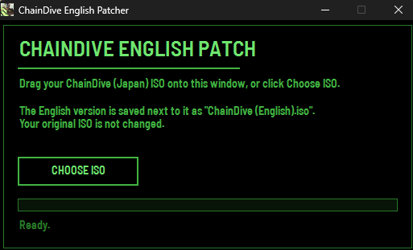

# ChainDive English Translation

An unofficial English fan translation of **ChainDive** (チェインダイブ), the 2003 PlayStation 2 action game developed by Alvion and published by Sony Computer Entertainment, released only in Japan (serial SCPS-15054).

**[Download the latest version](https://github.com/ohabibo/chaindive-english-patch/releases/latest)**

## What gets translated

- Story scenes and character names
- Radio messages during stages, mission goals and the training mode
- Menus, help text and memory card messages
- Text drawn inside pictures: the controller layout, stage names, mission results and memory card screens
- The training demo videos (PLAY SAMPLE 1 and 2): English captions and title cards
- The spoken dialogue in the opening and ending movies: English subtitles

The Japanese voice acting stays. The English text works like subtitles.

## What you need

- **Your own copy of ChainDive (Japan)**, dumped to an ISO file (a disc image). The patch contains no game files.
- The patch works with one ISO: a complete 1:1 dump of the Japanese disc (SCPS-15054). Every good dump of that disc is the same file, so a correct dump of your own disc works. The patcher checks this for you; the numbers below are only for checking it yourself with a tool:

  | Check | Value |
  |---|---|
  | File size | 1,232,306,176 bytes (Windows shows 1,203,424 KB) |
  | CRC32 | `07d33db1` |
  | MD5 | `1d607d78fde559f4485bb6fc49e8f983` |
  | SHA-1 | `179c0101ed4ffcf6c9f6bdce7cc71e084ece83b5` |

  Compressed images (CHD, CSO) have to be converted back to a plain ISO first.

- PCSX2 (a PlayStation 2 emulator), or a PlayStation 2 that can run your own backups.

## How to patch

Download the zip from the [releases](https://github.com/ohabibo/chaindive-english-patch/releases) and extract all of its files into one folder: the patcher uses the patch file next to it. The patch, `ChainDive-English.xdelta`, is a standard xdelta file. It holds only our changes, no complete game files.



1. Drag your ChainDive (Japan) ISO onto `ChainDivePatcher.exe`. You can also open the patcher and drop the ISO on its window, or click **Choose ISO**.
2. The patcher checks that it is the right ISO and saves `ChainDive (English).iso` in the same folder. Your original ISO is not changed.
3. Start the English ISO in PCSX2. No special settings are needed.

The patcher is not code-signed, so Windows may show "Windows protected your PC". Click **More info** and then **Run anyway**.

Any other xdelta tool works as well, on any system: for example [Rom Patcher JS](https://www.marcrobledo.com/RomPatcher.js/) in a web browser, Delta Patcher, xdelta UI, or `xdelta3 -d -s "ChainDive (Japan).iso" ChainDive-English.xdelta "ChainDive (English).iso"`. `ChainDive-English.sha1` lists the SHA-1 of the Japanese ISO and of the English one, if you want to check them.

On Mac or Linux you can also use Python 3: keep `ChainDive-English.xdelta` and `ChainDive-English.sha1` next to `apply_patch.py` and run:

```
python3 apply_patch.py "ChainDive (Japan).iso"
```

Questions about real hardware, compressed ISOs, saves or the patcher? See the [FAQ](docs/FAQ.md).

## Credits

- Project lead, translation and testing: ohabibo
- Font for the text in pictures and videos: Barlow by Jeremy Tribby (SIL Open Font License)

I am not a Japanese speaker. I used Claude, an AI model made by Anthropic, for the translation, and tried to keep every line accurate to the context of its scene, but it can still contain mistakes. The spoken lines in the opening and ending movies have no text in the game, so they were transcribed from the voices: Demucs and two RoFormer models (MelBand and BS) separated the voices from the music, and four speech recognisers wrote them down (Whisper large-v3 by OpenAI, Kotoba-Whisper, Anime Whisper and ReazonSpeech). If you find an inaccuracy, please [open an issue](https://github.com/ohabibo/chaindive-english-patch/issues) and quote the line, especially if you speak Japanese.

## Legal

This is a free, non-commercial fan project, not made or endorsed by Sony or Alvion. ChainDive is © 2003 Sony Computer Entertainment Inc. No game files are included. Please do not share patched ISO files; share the patch, so that everyone patches their own copy.
